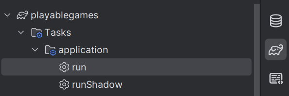

# PlayAble Game Store

## Overview
The Accessible App Store is a web-based platform designed to help users with accessibility needs discover and access applications tailored to their requirements. Unlike traditional app stores, our platform curates and highlights apps that are either natively accessible or have been modified to accommodate various accessibility needs.

The platform features an integrated voice command system powered by the Vosk speech recognition library, enabling hands-free navigation and interaction for users with motor impairments or visual disabilities.

## Features
- User Registration and authentication
- Game browsing: searching, sorting and filtering
- Voice command navigation
- Game reviews and ratings
- Admin panel for user and review management
- Accessibility-focused design
- Accessibility feedback system
- Community forums
- Adjustable visual, audio and interaction settings
- Favorite games list
- Nav-bar with quick access to main sections
- Account management


## Installation

### Requirements

Before installing, ensure you have the following:

- Java Development Kit (JDK) version 21
- MariaDB
- Git for version control
- IntelliJ IDEA 

### Setup Instructions

1. **Clone the repository**
```bash
   git clone https://git.cardiff.ac.uk/c23038311/group-8-accessible-app-store.git
   cd group-8-accessible-app-store
```


2. **Database Setup**
    - Install and start MariaDB
    - Create a new database for the application
    - Configure database connection settings in the application properties file


3. **Backend Setup**
    - In IntelliJ IDEA, open the cloned project
    - Navigate to gradle, on the right side bar
    - Press the run button in application file to start the backend server
 


4. **Frontend Setup**
5. Open a new terminal and run:
```bash
    cd web
    npm install
    npm run dev
```

## Project Requirements

Requirements can be found [here](https://git.cardiff.ac.uk/c23038311/group-8-accessible-app-store/-/requirements_management/requirements).


## Assumptions
- A user with hearing impairments was not born deaf, therefore they can use the voice command feature. (Requested by client)
- A user with visual impairments has some level of sight or can use assistive technologies to get to the settings page to turn on text to speech.
- Users have access to a microphone for voice commands.
- Users have access to a device that can run a web browser.
- Users have a stable internet connection to access the web application.
- Users that require additional accessibility hardware (e.g., screen readers, alternative input devices) have access to such hardware.
- Admin do not require voice command functionality.
- Users dont need to use voice commands to register or login to the application.

## Usage


## Support

For support, there are several options:

- **Database queries**: Check out the [database wiki](https://git.cardiff.ac.uk/c23038311/group-8-accessible-app-store/-/wikis/Understanding-the-Database) or contact Teah
- **Voice command queries**: Check out the [voice command wiki](https://git.cardiff.ac.uk/c23038311/group-8-accessible-app-store/-/wikis/Voice-Control-Information) or contact Aliza
- **Security queries**: Contact Adishree
- **General queries**: Open an issue on the Issue Board

### Documentation

Documentation for each library used in this project:

- [Vosk Speech Recognition Library](https://alphacephei.com/vosk/)
- [Micronaut Framework](https://docs.micronaut.io/index.html)
- [ReactJS Library](https://react.dev/learn)
- [CSS](https://developer.mozilla.org/en-US/docs/Web/CSS)
- [Java Programming Language](https://docs.oracle.com/en/java/)
- [MariaDB](https://mariadb.com/docs)

## Authors and Acknowledgments

This project was developed by:

- [Adishree Rajbhandari](https://git.cardiff.ac.uk/c23072307)
- [Aliza Arfi](https://git.cardiff.ac.uk/c23031398)
- [Anya Raval](https://git.cardiff.ac.uk/c23033156)
- [Teah Bannister](https://git.cardiff.ac.uk/c23038311)
- [Bunmi Onakomaya](https://git.cardiff.ac.uk/c23034155)

## Project Status

This project was developed as part of Commercial Frameworks, Languages and Tools at Cardiff University, 2025.